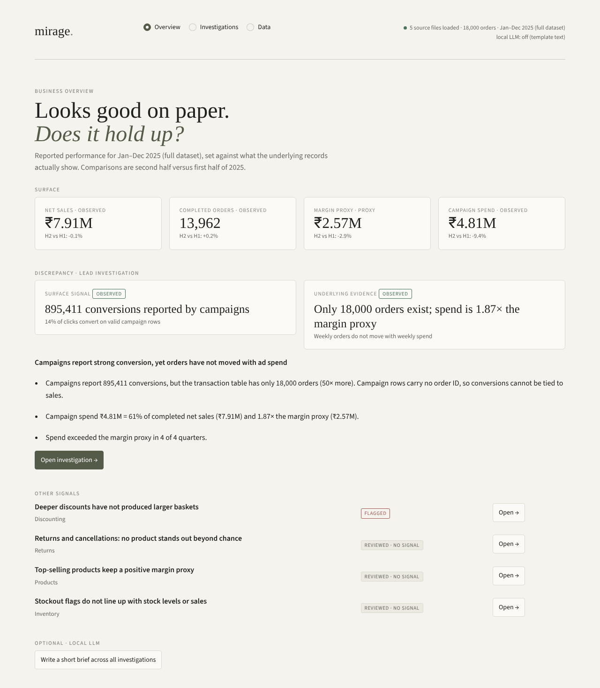
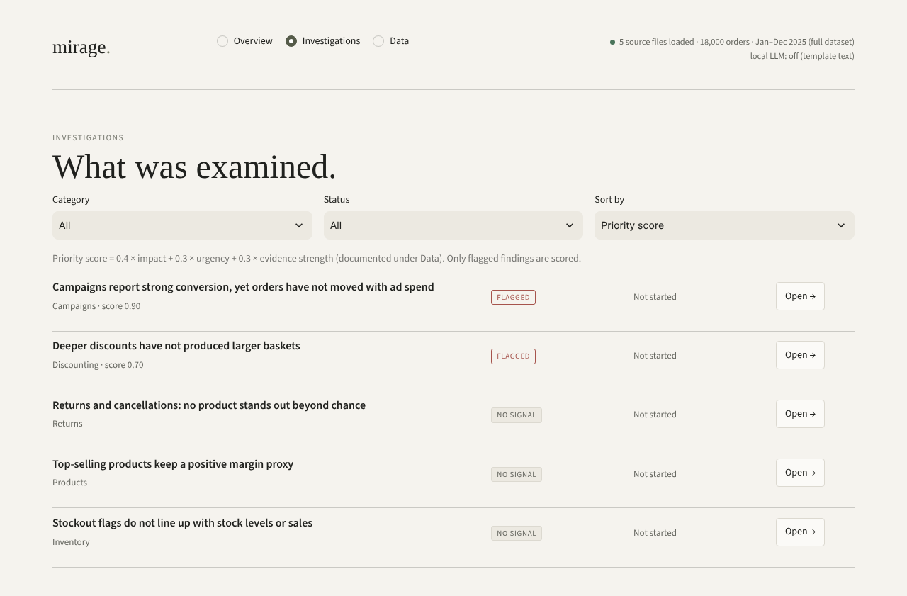
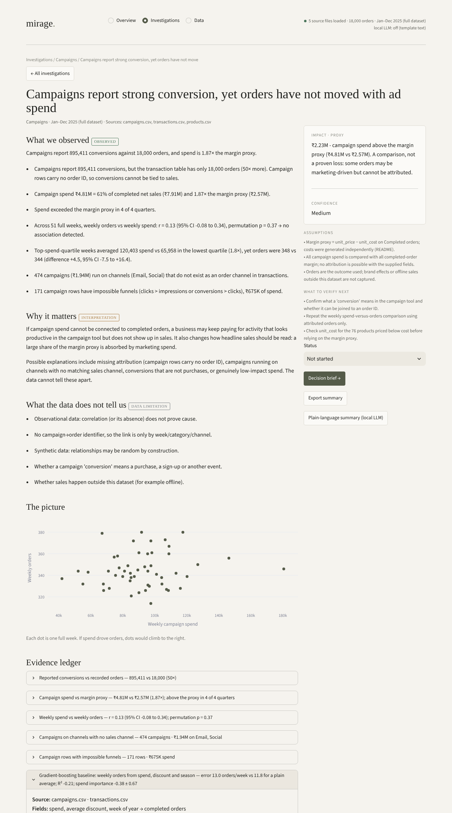
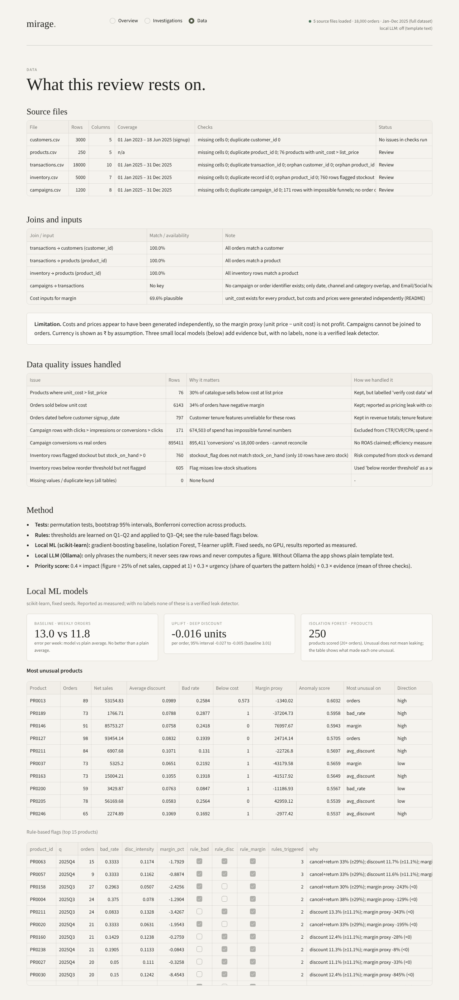

# mirage.

**Looks good on paper. Does it hold up?** An evidence-led review that sets a business's reported numbers against its raw records, tests whether a suspicious pattern is real, and says what to verify next.

DATATHON 2026 · Track: **The Money Leak** · Team **LARP** (Adhidev Jayaraj, Cavan J Paul)



## The problem
Businesses rarely lose money in one obvious hole. They lose it in places that *look* healthy: ad campaigns that report thousands of conversions, discounts that feel like marketing, products that sell well but quietly lose margin. Sales, returns, discounts, stock and campaign data sit in separate tables, so nobody checks whether the headline is backed by the records.

The track asks us to find revenue and operational problems in this data, investigate what drives them, and decide what to do.

## Target user
Small and mid-size retail owners and category/marketing managers who have no analytics team. They need to know **which contradiction matters first, how sure we are, and what to check before acting**, not another dashboard.

## What it finds on the track dataset
| Finding | Evidence |
|---|---|
| Campaigns vs orders | 895,411 reported conversions vs 18,000 orders; campaign spend is 1.87× the margin proxy |
| Ad spend vs sales | weekly orders do not move with weekly spend (r = 0.13, permutation p = 0.37) |
| Deep discounts | 15–25% discounts show no lift in units per order; the uplift model estimates about 0 extra units |
| Tested and **not** supported | returns, bestsellers, stockouts (shown openly, not hidden) |

"Margin proxy" = unit price − unit cost. It is never called profit, because costs in this dataset look unreliable. Every figure is labelled Observed, Proxy or Estimate.

## Screenshots
| Investigations | Investigation detail with evidence ledger |
|---|---|
|  |  |

Data health, join checks and the trained models:



## Our models (trained from scratch, in this repo)
All three are scikit-learn models trained on the track's own files, with fixed seeds, on CPU only. No pretrained weights and no external API are used for any result.

| # | Model | What it does | Result on the dataset |
|---|---|---|---|
| 1 | Gradient boosting (`HistGradientBoostingRegressor`) | learns weekly orders from spend, discount and season on the first 25 weeks, tested on the last 26 | error 13.0 orders/week vs 11.8 for a plain average, R² −0.21: no better than the average, so spend does not predict orders |
| 2 | Isolation Forest | scores all 250 products by how unusual their behaviour is (no labels needed) | ranked list with the feature that made each product stand out |
| 3 | T-learner uplift (two gradient-boosting models) | estimates extra units per order from a 15–25% discount on held-out orders | −0.016 units per order (95% interval −0.027 to −0.005) against a baseline of 3.01, i.e. about zero |

The verdicts also use permutation tests, bootstrap intervals, Bonferroni correction and rule thresholds learned on Q1–Q2 and applied to Q3–Q4 (`traps.py`). There are no labels in the dataset, so we claim no accuracy or precision: the models are evidence layers, not verified leak detectors, and weak results are reported as weak.

**Reproduce the training:**
```bash
python train.py
```
This loads `data/*.csv`, trains the three models and prints metrics. It also writes sample outputs, which are committed:
- [`docs/sample_outputs/model_report.json`](docs/sample_outputs/model_report.json): all metrics
- [`docs/sample_outputs/product_anomaly_scores.csv`](docs/sample_outputs/product_anomaly_scores.csv): Isolation Forest score for every product
- [`docs/sample_outputs/weekly_baseline_table.csv`](docs/sample_outputs/weekly_baseline_table.csv): weekly table with the train/test split

## Run the app
```bash
python -m venv .venv
# Windows: .venv\Scripts\activate       macOS/Linux: source .venv/bin/activate
python -m pip install -r requirements.txt
python -m streamlit run app.py
```
Open http://localhost:8501. Python 3.10+.

Screens: **Overview** (surface vs underlying evidence) → **Investigations** (list, detail with evidence ledger and the records behind every claim, decision brief, status tracker, export) → **Data** (source health, joins, method, models).

## Data and loading
The five track files are in [`data/`](data/) (`customers`, `products`, `transactions`, `inventory`, `campaigns`; see `data/README.txt`). `analysis.py` loads and joins them (`load_all`), builds order-level fields and runs the data-quality checks. To use another copy set `MONEY_LEAK_DATA=/path/to/folder`.

## Declarations: APIs, pretrained models, extra data
| Item | Declaration |
|---|---|
| External APIs | **None.** The app makes no API calls to any hosted AI or data service. |
| Pretrained models | **None are used for any result.** One *optional* pretrained open-source LLM (default `qwen2.5:7b`, run locally through [Ollama](https://ollama.com)) can phrase the already-computed facts as plain-language text. It receives only those facts, never raw rows, and never computes or changes a number. Without Ollama the app shows plain template text. |
| Extra datasets | **None.** Only the five track files. |
| Fonts | The page loads Inter and Instrument Serif from Google Fonts (CSS only), with system-font fallbacks. |
| Libraries | streamlit, pandas, numpy, plotly, jinja2, scikit-learn |

Optional local LLM:
```bash
ollama pull qwen2.5:7b      # fits a 6 GB GPU; any small instruct model works
```
The app detects Ollama automatically; the top-right status shows the model name or "off".

## Configuration (all optional)
| Variable | Meaning | Default |
|---|---|---|
| `MONEY_LEAK_DATA` | folder with the five CSVs | `./data` |
| `OLLAMA_HOST` | Ollama server | `http://localhost:11434` |
| `MONEY_LEAK_LLM` | LLM model name | first installed of qwen2.5:7b, llama3.1:8b, llama3.2:3b … |

No secrets are needed. `.env` files and runtime state are git-ignored.

## Hosting
Streamlit Community Cloud: use this folder as the repo root and `app.py` as the main file. Statistics and models run as usual; LLM wording falls back to template text (no Ollama there), and the status-tracker file does not persist on free hosting.

## Project layout
```
app.py        Streamlit UI (Overview / Investigations / Data)
train.py      trains the three models from the CSVs and writes sample outputs
ml.py         the three scikit-learn models
traps.py      statistical tests and the five investigations
findings.py   evidence ledger, records views, data-health checks
analysis.py   data loading, joins, data-quality checks
llm.py        optional local LLM wording (Ollama) with template fallback
theme.py      design tokens and CSS
data/         the track's five CSV files
docs/         screenshots, sample outputs, slide content
```

## Limitations
Synthetic data; observational, so association not cause; campaigns have no order key; costs unreliable so margin is a proxy; models are small and unvalidated because no reviewed labels exist. The tool supports decisions; it does not make them.
